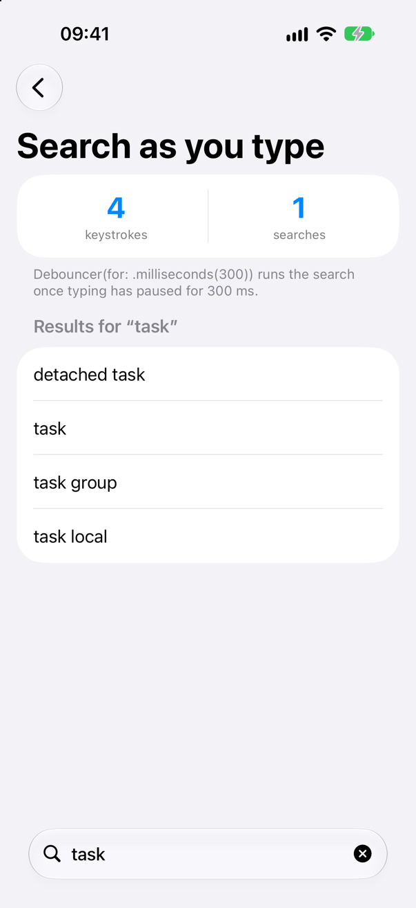
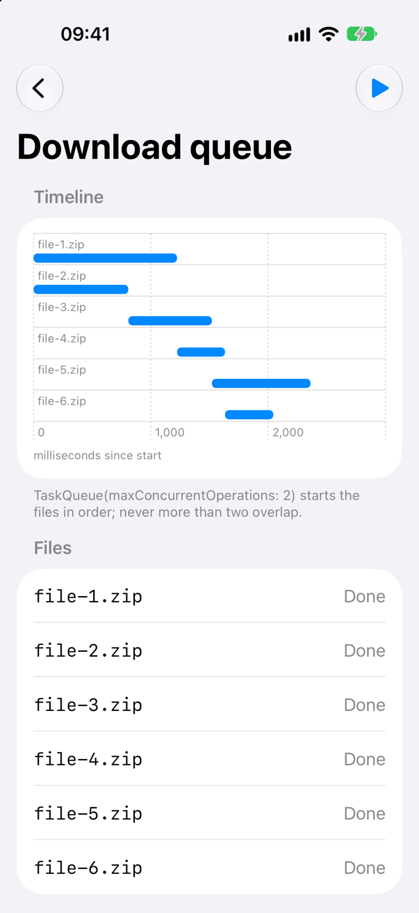
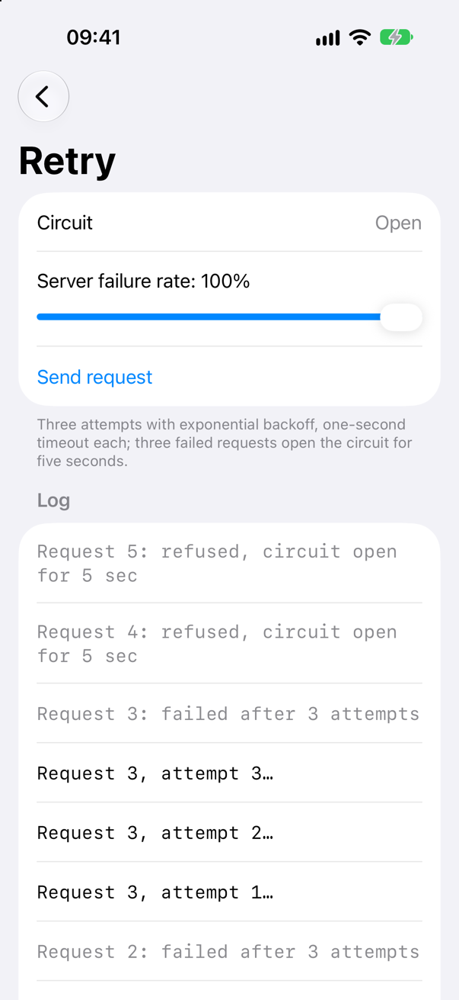

<!-- i18n-source: README.md@c10651cbbca1f6397d017fdd2da35aeeac02c073 status=reviewed -->
<!-- brand:start -->

<p align="center"><picture><source media="(prefers-color-scheme: dark)" srcset="https://raw.githubusercontent.com/muhittincamdali/SwiftConcurrency/main/.github/brand/banner-dark.svg"><source media="(prefers-color-scheme: light)" srcset="https://raw.githubusercontent.com/muhittincamdali/SwiftConcurrency/main/.github/brand/banner-light.svg"></picture></p>

<!-- lang-selector:start -->
<p align="center"><a href="README.md">English</a> · <a href="README.tr.md">Türkçe</a> · <a href="README.zh-CN.md">简体中文</a> · <a href="README.ja.md">日本語</a> · <a href="README.ko.md">한국어</a> · <a href="README.es.md">Español</a> · <a href="README.de.md">Deutsch</a> · <a href="README.fr.md">Français</a> · <a href="README.pt-BR.md">Português (Brasil)</a> · <a href="README.ru.md">Русский</a></p>
<!-- lang-selector:end -->

<p align="center">
<a href="https://github.com/muhittincamdali/SwiftConcurrency/actions/workflows/ci.yml"></a>
<a href="https://github.com/muhittincamdali/SwiftConcurrency/releases"><picture><source media="(prefers-color-scheme: dark)" srcset="https://raw.githubusercontent.com/muhittincamdali/SwiftConcurrency/main/.github/brand/badge-version-dark.svg"><source media="(prefers-color-scheme: light)" srcset="https://raw.githubusercontent.com/muhittincamdali/SwiftConcurrency/main/.github/brand/badge-version-light.svg"></picture></a>
<a href="https://github.com/muhittincamdali/SwiftConcurrency/blob/main/Package.swift"><picture><source media="(prefers-color-scheme: dark)" srcset="https://raw.githubusercontent.com/muhittincamdali/SwiftConcurrency/main/.github/brand/badge-platforms-dark.svg"><source media="(prefers-color-scheme: light)" srcset="https://raw.githubusercontent.com/muhittincamdali/SwiftConcurrency/main/.github/brand/badge-platforms-light.svg"></picture></a>
<a href="https://github.com/muhittincamdali/SwiftConcurrency/blob/main/Package.swift"><picture><source media="(prefers-color-scheme: dark)" srcset="https://raw.githubusercontent.com/muhittincamdali/SwiftConcurrency/main/.github/brand/badge-language-dark.svg"><source media="(prefers-color-scheme: light)" srcset="https://raw.githubusercontent.com/muhittincamdali/SwiftConcurrency/main/.github/brand/badge-language-light.svg"></picture></a>
<a href="https://github.com/muhittincamdali/SwiftConcurrency/blob/main/LICENSE"><picture><source media="(prefers-color-scheme: dark)" srcset="https://raw.githubusercontent.com/muhittincamdali/SwiftConcurrency/main/.github/brand/badge-license-dark.svg"><source media="(prefers-color-scheme: light)" srcset="https://raw.githubusercontent.com/muhittincamdali/SwiftConcurrency/main/.github/brand/badge-license-light.svg"></picture></a>
</p>

<p align="center">
<a href="#início-rápido"><picture><source media="(prefers-color-scheme: dark)" srcset="https://raw.githubusercontent.com/muhittincamdali/SwiftConcurrency/main/.github/brand/button-start-pt-BR-dark.svg"><source media="(prefers-color-scheme: light)" srcset="https://raw.githubusercontent.com/muhittincamdali/SwiftConcurrency/main/.github/brand/button-start-pt-BR-light.svg"></picture></a>
<a href="https://muhittincamdali.github.io/SwiftConcurrency/documentation/swiftconcurrency/"><picture><source media="(prefers-color-scheme: dark)" srcset="https://raw.githubusercontent.com/muhittincamdali/SwiftConcurrency/main/.github/brand/button-docs-pt-BR-dark.svg"><source media="(prefers-color-scheme: light)" srcset="https://raw.githubusercontent.com/muhittincamdali/SwiftConcurrency/main/.github/brand/button-docs-pt-BR-light.svg"></picture></a>
<a href="https://github.com/muhittincamdali/SwiftConcurrency/tree/main/Examples"><picture><source media="(prefers-color-scheme: dark)" srcset="https://raw.githubusercontent.com/muhittincamdali/SwiftConcurrency/main/.github/brand/button-examples-pt-BR-dark.svg"><source media="(prefers-color-scheme: light)" srcset="https://raw.githubusercontent.com/muhittincamdali/SwiftConcurrency/main/.github/brand/button-examples-pt-BR-light.svg"></picture></a>
</p>

> Esta é uma tradução do README em inglês. Se houver diferença, vale a versão em inglês.

<!-- brand:end -->

SwiftConcurrency é um pacote pequeno de Swift 6 para os problemas do dia a dia em torno de `async`/`await` que a biblioteca padrão deixa para cada app resolver: baixar no máximo quatro arquivos por vez, impedir que dois salvamentos se sobreponham, desistir de uma requisição após dez segundos, tentar de novo com backoff, pesquisar só depois que o usuário para de digitar, enviar uma única requisição quando três telas pedem os mesmos dados e parar de chamar um servidor que está fora do ar. Cada problema tem um tipo ou uma função; todos são `Sendable`, encerram suas esperas quando a tarefa é cancelada e recebem um `Clock`, para que os testes possam avançar o tempo em vez de esperar por ele. Não tem dependências.

## Destaques

- **Ordem e limites** — `TaskQueue` executa operações assíncronas na ordem em que foram adicionadas, uma de cada vez ou até um limite que você escolhe; `AsyncSemaphore` e `concurrentMap(maxConcurrency:)` limitam quanto é executado ao mesmo tempo.
- **Prazos e novas tentativas** — `withTimeout`, `withDeadline` e `retry` com `Backoff` constante, linear ou exponencial e jitter; os atrasos são limitados antes de virarem uma `Duration`, então nenhum número de tentativas ou multiplicador causa estouro.
- **Controle de frequência para código de UI** — `Debouncer` para campos de busca e `Throttler` (execuções no início e no fim) para handlers de rolagem e arrasto, como objetos simples que você chama a partir de um view model.
- **Falhar rápido, compartilhar trabalho** — `CircuitBreaker` deixa de chamar um serviço que continua falhando; `SingleFlight` envia uma única requisição quando muitos chamadores pedem a mesma chave ao mesmo tempo.
- **Cancelamento em todo lugar** — toda espera do pacote termina imediatamente quando sua tarefa é cancelada; um chamador cancelado não pega nenhuma permissão, nunca executa sua operação e não deixa nada na memória.
- **Testes que não esperam** — `TestClock` e `waitForSleepers()` permitem que um teste encerre um backoff de 30 segundos na linha que escolher, com o mesmo resultado a cada execução.

## Início rápido

**1. Adicione o pacote**

No Xcode, escolha **File › Add Package Dependencies…** e informe a URL do repositório:

```text
https://github.com/muhittincamdali/SwiftConcurrency.git
```

**2. Importe o módulo**

```swift
import SwiftConcurrency
```

**3. Use**

Carregue muitos perfis, quatro requisições por vez, cada uma com tempo limite de 10 segundos e até três tentativas com backoff exponencial
([ReadmeSamples.swift](Examples/ConcurrencyDemo/ConcurrencyDemo/ReadmeSamples.swift)):

```swift
func loadProfiles(ids: [Int], from api: some ProfileAPI) async throws -> [Profile] {
    try await ids.concurrentMap(maxConcurrency: 4) { id in
        try await retry(maxAttempts: 3, backoff: .exponential().jittered(.full)) { _ in
            try await withTimeout(.seconds(10)) {
                try await api.profile(id: id)
            }
        }
    }
}
```

`ProfileAPI` representa o seu código de rede: qualquer tipo `Sendable` com um método assíncrono `profile(id:)`. Os resultados voltam na ordem de `ids`. Se uma requisição ainda falhar depois de três tentativas, o erro dela é lançado sem alteração e as requisições que ainda estão em andamento são canceladas.

## Instalação

### Swift Package Manager

No Xcode, escolha **File › Add Package Dependencies…** e informe a URL do repositório:

```text
https://github.com/muhittincamdali/SwiftConcurrency.git
```

Ou adicione-o às `dependencies` do seu `Package.swift`:

```swift
dependencies: [
    .package(url: "https://github.com/muhittincamdali/SwiftConcurrency.git", branch: "main")
],
targets: [
    .target(name: "YourApp", dependencies: [
        .product(name: "SwiftConcurrency", package: "SwiftConcurrency")
    ])
]
```

## Uso

Os exemplos abaixo foram copiados de
[`ReadmeSamples.swift`](Examples/ConcurrencyDemo/ConcurrencyDemo/ReadmeSamples.swift), que o app de exemplo compila e a suíte de testes executa.

### Buscar enquanto se digita

`Debouncer` executa a busca depois que o usuário para de digitar por 300 ms. Cada nova tecla pressionada substitui a busca que estava em espera.

```swift
@MainActor
final class SearchController {
    private(set) var results: [String] = []
    private(set) var searchCount = 0
    private let debouncer: Debouncer
    private let search: @Sendable (String) async -> [String]

    init(
        clock: some Clock<Duration> = ContinuousClock(),
        search: @escaping @Sendable (String) async -> [String]
    ) {
        self.debouncer = Debouncer(for: .milliseconds(300), clock: clock)
        self.search = search
    }

    func queryChanged(_ query: String) {
        debouncer.submit { [search] in
            let results = await search(query)
            await self.show(results)
        }
    }

    private func show(_ results: [String]) {
        self.results = results
        searchCount += 1
    }
}
```

### Evitar que salvamentos se sobreponham

Um actor permite que a próxima chamada comece enquanto a anterior está esperando. `TaskQueue` não: com o limite padrão de 1, cada gravação começa depois que a anterior termina, na ordem das chamadas a `save`.

```swift
final class Autosaver: Sendable {
    private let queue = TaskQueue()
    private let write: @Sendable (String) async throws -> Void

    init(write: @escaping @Sendable (String) async throws -> Void) {
        self.write = write
    }

    func save(_ text: String) {
        queue.addOperation { [write] in
            try await write(text)
        }
    }

    func waitForPendingSaves() async throws {
        try await queue.waitUntilIdle()
    }
}
```

`TaskQueue(maxConcurrentOperations: 4)` executa até quatro operações ao mesmo tempo e ainda as inicia em ordem.

### Enviar uma requisição para vários chamadores

`SingleFlight` compartilha a requisição que já está em andamento para um perfil, e `CircuitBreaker` recusa chamadas por 30 segundos depois de cinco falhas seguidas.

```swift
final class ProfileLoader: Sendable {
    private let api: any ProfileAPI
    let inFlight = SingleFlight<Int, Profile>()
    private let breaker: CircuitBreaker

    init(api: any ProfileAPI, clock: some Clock<Duration> = ContinuousClock()) {
        self.api = api
        self.breaker = CircuitBreaker(failureThreshold: 5, resetTimeout: .seconds(30), clock: clock)
    }

    func profile(id: Int) async throws -> Profile {
        try await inFlight.value(for: id) { [api, breaker] in
            try await breaker.run {
                try await api.profile(id: id)
            }
        }
    }
}
```

### Testar sem esperar

Passe um `TestClock`, espere até o código dormir e então avance o tempo você mesmo. Este teste de
[`ReadmeSamplesTests.swift`](Tests/SwiftConcurrencyTests/ReadmeSamplesTests.swift) digita quatro letras e verifica que apenas a última consulta é pesquisada:

```swift
let clock = TestClock()
let searched = Recorder<String>()
let controller = SearchController(clock: clock) { query in
    await searched.append(query)
    return ["\(query) result"]
}
for query in ["t", "ta", "tas", "task"] {
    controller.queryChanged(query)
}
try await clock.waitForSleepers()
clock.advance(by: .milliseconds(300))
#expect(await searched.wait(forCount: 1) == ["task"])
```

`Recorder` é um pequeno actor no target de testes que coleta valores e espera por eles.

## Demonstração

O app [ConcurrencyDemo](Examples/ConcurrencyDemo) executa cada ferramenta com a biblioteca real. As capturas de tela vêm do app em um simulador de iOS 27 e foram feitas por
[`scripts/capture-example-screens.sh`](scripts/capture-example-screens.sh):

| Busca com debounce | Fila de downloads (limite 2) | Nova tentativa e circuit breaker |
| --- | --- | --- |
| <picture><source media="(prefers-color-scheme: dark)" srcset="docs/images/demo-search-dark.png"></picture> | <picture><source media="(prefers-color-scheme: dark)" srcset="docs/images/demo-downloads-dark.png"></picture> | <picture><source media="(prefers-color-scheme: dark)" srcset="docs/images/demo-retry-dark.png"></picture> |

Para executá-lo, abra `ConcurrencyDemo.xcodeproj` em [Examples/ConcurrencyDemo](Examples/ConcurrencyDemo) com o Xcode 26 ou posterior, escolha um simulador de iPhone ou **My Mac** e clique em **Run**.
[Examples/README.md](Examples/README.md) descreve cada tela.

## Documentação

Referência da API e artigos:

- [Referência do SwiftConcurrency](https://muhittincamdali.github.io/SwiftConcurrency/documentation/swiftconcurrency/)
- [Primeiros passos](https://muhittincamdali.github.io/SwiftConcurrency/documentation/swiftconcurrency/gettingstarted)
- [Testando código dependente de tempo](https://muhittincamdali.github.io/SwiftConcurrency/documentation/swiftconcurrency/testingtimebasedcode)
- [Cancelamento e limites](https://muhittincamdali.github.io/SwiftConcurrency/documentation/swiftconcurrency/cancellationandlimits)

## Guias

- [Primeiros passos](Sources/SwiftConcurrency/SwiftConcurrency.docc/GettingStarted.md) — qual tipo resolve qual problema, com um exemplo para cada um.
- [Testando código dependente de tempo](Sources/SwiftConcurrency/SwiftConcurrency.docc/TestingTimeBasedCode.md)
  — o fluxo de trabalho com `TestClock`: criar, esperar os que dormem, avançar.
- [Cancelamento e limites](Sources/SwiftConcurrency/SwiftConcurrency.docc/CancellationAndLimits.md)
  — o que cada API faz quando sua tarefa é cancelada, quais entradas ela rejeita e como ela limita a memória.

## Requisitos

| Plataforma | Versão mínima |
| --- | --- |
| iOS | 16 |
| macOS | 13 |
| tvOS | 16 |
| watchOS | 9 |
| visionOS | 1 |
| Ferramentas | Swift 6.2 · Xcode 26+ |

## Arquitetura

O pacote é um único módulo, `SwiftConcurrency`, agrupado por problema:

| Pasta | Tipos |
| --- | --- |
| `Synchronization/` | `AsyncSemaphore` |
| `Tasks/` | `TaskQueue`, `SingleFlight`, `withTimeout` / `withDeadline`, `concurrentMap` / `concurrentForEach` |
| `Resilience/` | `retry`, `Backoff`, `CircuitBreaker` |
| `Rate/` | `Debouncer`, `Throttler` |
| `Testing/` | `TestClock` |
| `Internal/` | `Locked` (um unfair lock), `WaiterQueue` (FIFO de chamadores suspensos), `ElapsedClock` |

Decisões de design:

- **Classes com lock, não actors.** `signal()`, `cancel()`, `submit(_:)` e `advance(by:)` têm efeito antes de retornar, então podem ser chamados de código síncrono, de `defer` e de testes, sem um `await` que deixe outro trabalho rodar no meio.
- **Chamadores suspensos são continuations em uma `WaiterQueue`.** Um handler de cancelamento remove a própria entrada sob o mesmo lock que a registra, de modo que nenhum chamador se perde nem é retomado duas vezes.
- **As operações rodam no actor do chamador sempre que possível.** `retry`, `AsyncSemaphore.withPermit` e `CircuitBreaker.run` são `nonisolated(nonsending)`, então os closures que você passa podem acessar o estado do main actor e não precisam de capturas `Sendable`. O trabalho que precisa rodar em outra tarefa (`TaskQueue`, `SingleFlight`, `withTimeout`, `concurrentMap`) recebe closures `@Sendable`.
- **Todo tipo com tempo recebe um `Clock`.** O código de produção usa `ContinuousClock`; os testes passam um `TestClock`.

### Onde ele se encaixa

[swift-async-algorithms](https://github.com/apple/swift-async-algorithms) cobre operadores sobre `AsyncSequence` (`debounce`, `throttle`, `merge`, `zip`, `AsyncChannel`); use-o quando seus dados já chegam como uma sequência. SwiftConcurrency cobre o trabalho iniciado por chamadas: limites, filas, prazos, novas tentativas, debounce de uma chamada de método, circuit breaking e requisições compartilhadas. Os dois pacotes funcionam lado a lado.

## Roteiro

- Suporte a Linux: substituir `OSAllocatedUnfairLock` pelo `Mutex` da biblioteca padrão, o que exige elevar as versões mínimas das plataformas Apple para iOS 18 e macOS 15.
- Um limitador de taxa do tipo token bucket para APIs que permitem um número de requisições por segundo.
- Uma opção de prioridade para `TaskQueue`, para que operações urgentes possam começar antes das mais antigas.

## Como contribuir

Contribuições são bem-vindas. Leia o [guia de contribuição](https://github.com/muhittincamdali/SwiftConcurrency/blob/main/CONTRIBUTING.md) e o [código de conduta](https://github.com/muhittincamdali/SwiftConcurrency/blob/main/CODE_OF_CONDUCT.md) antes de abrir um pull request. Relate problemas de segurança de forma privada, como descrito na [política de segurança](https://github.com/muhittincamdali/SwiftConcurrency/blob/main/SECURITY.md).

## Licença

Publicado sob a licença MIT. Veja [LICENSE](LICENSE).
